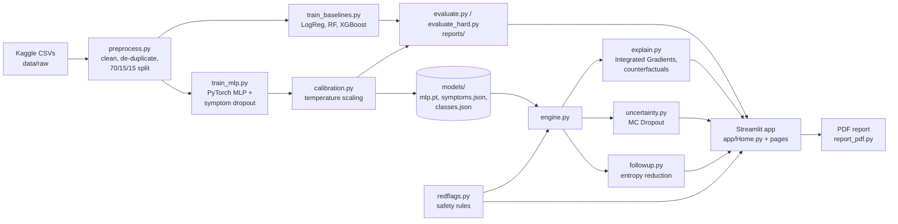

# RogMitra.AI: Explainable Disease Prediction from Symptoms

An explainable-AI web app that suggests the most likely diseases from a patient's symptoms and shows
**why**, **how sure it is**, and **what to do next**. Every model is trained from scratch on public
datasets. No pretrained medical API and no language model is used to make a prediction.

> **Academic project. Not a medical device and not a diagnosis.** RogMitra.AI demonstrates explainable AI on
> public data. For any health concern please consult a qualified doctor; in an emergency call your local
> emergency number.


*(screenshot placeholder: see [Screenshots](#screenshots) for how to capture it)*

---

## Features

| Area | What the app does |
|---|---|
| Prediction | Top-3 diseases with **calibrated** probabilities (temperature scaling) |
| Explanation | Per-symptom contribution chart (Integrated Gradients), plain-language sentence, global SHAP importance |
| What-if | **Counterfactuals**: "if you did not have X, the top prediction would change to Y / confidence drops from 82% to 55%" |
| Next question | **Follow-up suggester**: the symptom whose answer reduces uncertainty the most; one click adds it and re-predicts |
| Uncertainty | 30-pass **Monte Carlo Dropout** confidence range; "the model is unsure" when confidence is low, the top two are close, or too few symptoms were given |
| Safety | Rule-based **red-flag layer** (chest pain, breathing difficulty, loss of consciousness, stroke signs...) that overrides the model with an emergency banner; permanent disclaimer |
| Information | Disease description, precautions and mild home-care notes with source links and a "see a doctor if..." note |
| Report | Downloadable **PDF report** of each result |
| Evaluation | Baselines, 5-fold cross-validation, calibration (ECE), missing-symptom robustness, and stricter novel-pattern / noisy-input tests |
| Optional | DistilBERT free-text model and a synthetic multi-label experiment (both can be skipped) |
| UI | 4-page Streamlit app, dark and light themes, responsive on phones |

## Architecture



Training happens offline with the scripts in `src/`. The app only **loads** the saved model; it never trains.

## Datasets and licences

| Dataset | Used for | Source |
|---|---|---|
| Disease Symptom Prediction (Pranay Patil): `dataset.csv`, `symptom_Description.csv`, `symptom_precaution.csv`, `Symptom-severity.csv` | Main structured model, descriptions, precautions | <https://www.kaggle.com/datasets/itachi9604/disease-symptom-description-dataset> |
| Symptom2Disease (Niyar R Barman) | Optional free-text model | <https://www.kaggle.com/datasets/niyarrbarman/symptom2disease> |
| `data/remedies.json` | Home-care notes | Curated by the project author from NHS, MedlinePlus and Mayo Clinic pages (each entry stores its source URL) |

* The Kaggle files are **not** redistributed in this repository. Download them yourself (see below) and check each dataset's
  licence on its Kaggle page before reusing the data.
* `data/processed/` holds small files derived from the dataset so the deployed app can start; remove it and run
  `python -m src.preprocess` if you prefer not to publish derived data.
* `data/remedies.json` entries carry a `verified` flag. An entry is shown as "reviewed against the source" only after
  its link has been opened and checked and the flag set to `true`.

## Installation

Requires Python 3.10 to 3.12. Work inside a virtual environment, or global packages will clash with the pinned versions.

```bash
python -m venv .venv
# Windows:  .venv\Scripts\activate        macOS / Linux:  source .venv/bin/activate

# CPU-only PyTorch first (much smaller than the default build), then everything else
pip install torch==2.4.1 --index-url https://download.pytorch.org/whl/cpu
pip install -r requirements.txt
```

### Get the data

Option A, Kaggle CLI (needs `~/.kaggle/kaggle.json`; never commit that file):

```bash
python -m src.download_data
```

Option B, manual: download both datasets from the links above and place the CSV files in `data/raw/`
(`dataset.csv`, `symptom_Description.csv`, `symptom_precaution.csv`, `Symptom-severity.csv`, and `Symptom2Disease.csv` for the optional text model).

## Run

Everything in one go (a few minutes on a laptop CPU):

```bash
bash run_all.sh                 # add --with-text for the optional DistilBERT and multi-label models
```

Or step by step:

```bash
python -m src.preprocess        # clean, de-duplicate BEFORE splitting, stratified 70/15/15 split (seed 42)
python -m src.eda               # dataset statistics and class-balance plots
python -m src.train_baselines   # Logistic Regression, Random Forest, XGBoost
python -m src.train_mlp         # PyTorch MLP with symptom-dropout augmentation + temperature scaling
python -m src.evaluate          # metrics, confusion matrix, ROC-AUC, calibration, robustness, 5-fold CV
python -m src.evaluate_hard     # stricter tests: novel patterns and noisy input
python -m src.explain           # global SHAP importance per model
python -m src.sanity_check      # compare top SHAP symptoms with the dataset's disease-symptom map
python -m src.update_readme     # copy your own metrics tables into this README
python -m src.check_remedies --online   # check that each remedy source URL opens
streamlit run app/Home.py       # launch the app
python -m pytest -q             # unit tests
```

`make <target>` runs the same commands (`make all`, `make app`, `make test`).

## Results

The tables below are written by `python -m src.update_readme` from the files in `reports/`, so they always match your
own run. Run `evaluate` and `evaluate_hard` first.

<!-- METRICS:START -->
### Model comparison (test split, n = 45)

| Model | Accuracy | Macro F1 | Weighted F1 | Precision | Recall | Top-3 | ROC-AUC | ECE | CV acc (%) | CV macro F1 (%) | CV top-3 (%) |
|---|---|---|---|---|---|---|---|---|---|---|---|
| Logistic Regression | 1.000 | 1.000 | 1.000 | 1.000 | 1.000 | 1.000 | 1.000 | 0.051 | 100.0 ± 0.0 | 100.0 ± 0.0 | 100.0 ± 0.0 |
| Random Forest | 1.000 | 1.000 | 1.000 | 1.000 | 1.000 | 1.000 | 1.000 | 0.044 | 100.0 ± 0.0 | 100.0 ± 0.0 | 100.0 ± 0.0 |
| XGBoost | 1.000 | 1.000 | 1.000 | 1.000 | 1.000 | 1.000 | 1.000 | 0.026 | 99.7 ± 0.7 | 99.4 ± 1.2 | 100.0 ± 0.0 |
| MLP (calibrated) | 1.000 | 1.000 | 1.000 | 1.000 | 1.000 | 1.000 | 1.000 | 0.000 | 100.0 ± 0.0 | 100.0 ± 0.0 | 100.0 ± 0.0 |

The MLP row uses temperature-scaled probabilities (so its ECE is the calibrated one); CV rows use the uncalibrated MLP trained for a fixed number of epochs.

### Stricter tests (test n = 45; novel-pattern subset n = 11)

| Model | Train | Validation | Test | Novel patterns only | Noisy input (+2 wrong symptoms) |
|---|---|---|---|---|---|
| Logistic Regression | 100.0% | 100.0% | 100.0% | 100.0% | 96.4% |
| Random Forest | 100.0% | 100.0% | 100.0% | 100.0% | 91.7% |
| XGBoost | 100.0% | 100.0% | 100.0% | 100.0% | 85.6% |
| MLP (calibrated) | 100.0% | 100.0% | 100.0% | 100.0% | 96.2% |

*Noisy input: 30% of each patient's real symptoms removed and two unrelated symptoms added, averaged over repeated random draws. The novel-pattern subset is small, so treat it as an indication.*
<!-- METRICS:END -->

### How to read these numbers

The public symptom dataset is clean and largely synthetic: each disease is a small set of textbook symptom lists, and
many rows are near-copies of each other. **High accuracy therefore reflects the simplicity of the dataset, not
clinical reliability.** Simple models such as logistic regression score almost the same as the neural network, which
is the signature of an easy dataset rather than a memorising model. To keep the evaluation honest the project:

1. removes duplicate rows **before** splitting, so identical patients never appear in both train and test;
2. reports a train / validation / test comparison to check for an overfitting gap;
3. adds stricter tests (novel patterns only, wrong symptoms added) and a missing-symptom robustness curve;
4. reports calibration (ECE) because a confident but wrong answer is worse than an honest "unsure".

## Explainability examples

* **Local:** "Your top supporting symptoms for *Malaria* were chills (+0.31), high fever (+0.22) and sweating (+0.18).
  Headache slightly reduced its likelihood." (values come from Integrated Gradients; the numbers shown by the app are
  those of your own trained model.)
* **Counterfactual:** "If you did not have *chills*, the top prediction would change to *Typhoid* / confidence would drop
  from 82% to 55%."
* **Follow-up:** "Do you also have *sweating*? This answer is expected to reduce uncertainty the most."
* **Global:** SHAP bar plots per model are in `reports/figures/` and on the *Model Performance* page.

## Project structure

```
RogMitra.AI/
  app/                Streamlit app: Home.py, pages/, theme.py, charts.py, common.py
  src/                preprocess, models, training, evaluation, explain, uncertainty, followup, redflags, report_pdf, config
  data/               raw/ (not committed), processed/, remedies.json
  models/             trained weights, symptom list, class list
  reports/            metrics, figures, analysis
  tests/              pytest suite
  docs/               DEPLOYMENT.md, VIVA_CHEATSHEET.md, screenshots/
  notebooks/01_eda.ipynb
  Dockerfile, requirements.txt, requirements-deploy.txt, run_all.sh, Makefile
```

## Limitations and ethics

* The model learns from a small, idealised, mostly synthetic dataset. It has never seen real patients, so it must not be
  used for real medical decisions.
* It uses symptoms only (no age, history or test results) and can only name diseases that are in the dataset.
* The input cannot express "definitely absent"; unreported symptoms are treated as absent.
* Explanations describe what the **model** relies on. They are not medical causation.
* Probabilities are calibrated on a small validation set; calibration reduces over-confidence but does not remove it.
* The emergency layer is a conservative keyword rule set, not a triage system.
* The dataset has no demographic information, so fairness across groups could not be audited. Age and sex are therefore
  not model inputs.
* Home-care notes are short summaries written for this project and must be checked against their cited sources.
* Typed text stays in the user's session and is not stored.

## Future work

Validate on de-identified real clinical data with ethical approval; three-state symptom input (present / absent /
unknown); deep ensembles or conformal prediction for uncertainty; clinician review of the red-flag rules, explanations
and home-care text; more diseases and clinical context features; a fairness audit once demographic data is available.

## Deployment

Short version (full steps in [docs/DEPLOYMENT.md](docs/DEPLOYMENT.md)):

* **Streamlit Community Cloud:** push the repository to GitHub, create an app with main file `app/Home.py`. Dependencies
  are read from `app/requirements.txt` (the lean runtime list).
* **Hugging Face Spaces (Docker):** create a Docker Space, add the metadata block from the guide to its `README.md`, push.
* **Docker anywhere:** `docker build -t rogmitra-ai .` then `docker run --rm -p 8501:7860 rogmitra-ai`.

The repository must contain `models/`, `data/processed/`, `reports/` and `data/remedies.json`, because the deployed app
loads them instead of training.

## Screenshots

Capture these from your own run and save them in `docs/screenshots/` (the README links to the first one):

| File | Page |
|---|---|
| `check_symptoms.png` | Check Symptoms |
| `results.png` | Results (top-3, explanation, counterfactuals) |
| `model_performance.png` | Model Performance |
| `about.png` | About & Limitations |

## Licence

MIT, see [LICENSE](LICENSE). The datasets keep their own licences.
